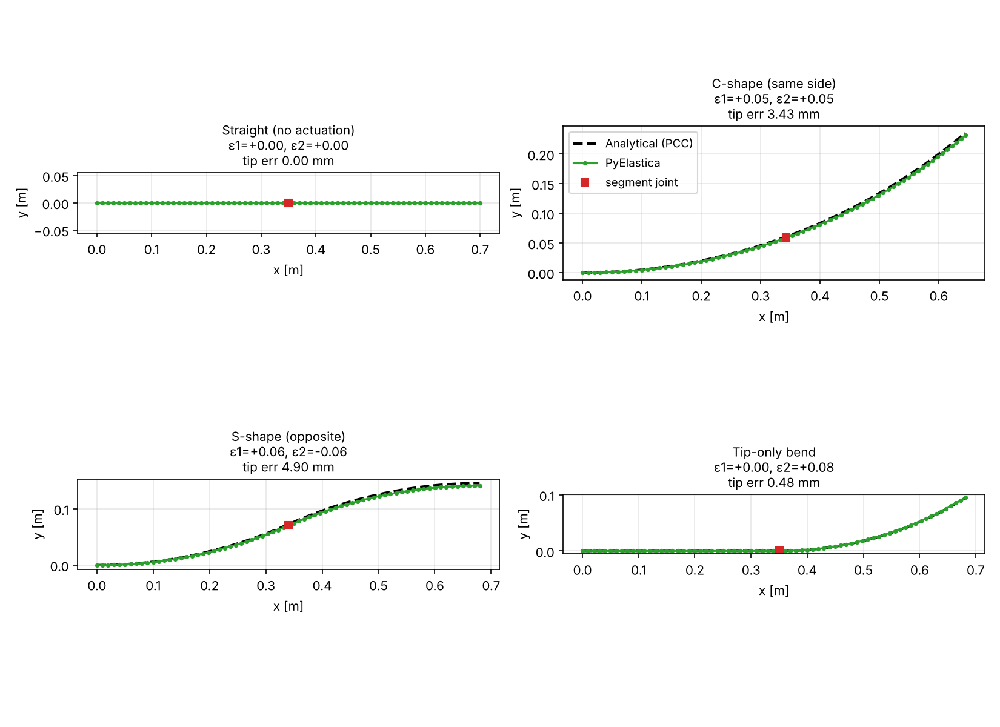

# Vine Robot Model

Physics models for a two-segment, sPAM-steered vine robot (Olin ISR, Fall 2026: Aditi Lagisetty, Havalyn Hale; advisor John Bell).

This repo is the **modeling side** of the project, built before any hardware exists. It gives every bench test (B0–B5) a prediction to compare against.



## What's here

| Path | What it does |
|---|---|
| `src/vine_baseline.py` | PyElastica (Cosserat rod) model of the vine: C-, S- and tip-only shapes, a tip-load sweep, and a mesh-convergence check |
| `src/hand_calcs.py` | The analytical models, printed step by step |
| `src/large_deflection_check.py` | Large-deflection beam solution (SciPy) used to validate PyElastica |
| `src/draw_geometry.py` | Draws the geometry diagram in the docs |
| `docs/hand_calculations.md` | **Derivations and worked examples** for every hand calculation |
| `figures/` | Generated plots and printed results |

## Quick start

```bash
pip install -r requirements.txt
python src/hand_calcs.py               # instant
python src/large_deflection_check.py   # instant
python src/vine_baseline.py            # ~6 min, writes figures/
```

## Model in one paragraph

Each sPAM shortens one side of its segment by a strain ε, which bends the segment to a curvature **κ ≈ ε/d** (d = body diameter). In PyElastica this is a *rest curvature* on that segment. With no external loads, each segment should form a circular arc, so the simulation is checked against hand-calculated chained arcs (piecewise-constant curvature). The body's bending stiffness `EI_eff` only matters once there are loads or contact, and it's checked separately against cantilever beam theory.

## Validation so far

| Check | Result |
|---|---|
| Shapes vs. hand-calculated arcs | tip within 4.2 mm on a 700 mm vine (under 0.6% of length) |
| Mesh convergence (S-shape) | 16.9 → 4.2 → 2.2 mm at 35 → 70 → 140 elements |
| Tip load vs. large-deflection beam theory | within 2% |

## Placeholders to replace with measurements

| Parameter | Current | Replace using |
|---|---|---|
| `d` body diameter | 0.05 m | your tube |
| `EI_eff` bending stiffness | 0.05 N·m² | **B0**: $EI = FL^3 / 3\delta$ at small loads, 3 body pressures |
| `eps` sPAM strain vs. pressure | 0.05–0.08 | **B2**: free contraction bench test |
| κ vs. ε/d reduction | none assumed | **B3**: curvature vs. sPAM/body pressure ratio |

## Gotchas

1. **PyElastica assumes a solid rod** (I = πr⁴/4). Set `E = EI_eff / (πr⁴/4)`. Using the thin-tube I makes the vine 6.25× too stiff.
2. **Soft rods settle slowly.** The script warns if the tip is still moving at the end of the run. Never read a shape before it has settled.
3. **Linear beam theory only works for small deflections** (δ/L < ~0.1). Size B0 loads accordingly.

## Next steps (no hardware needed)

- [ ] Add a peg with `ea.RodCylinderContact` (prep for B5 and the N1 self-sensing idea)
- [ ] Add a simple κ-reduction factor as a function of sPAM/body pressure ratio, ready to fit to B3 data
- [ ] Novelty-check literature searches for N1, N2, N4
- [ ] Model growth (time-varying length) for B4
