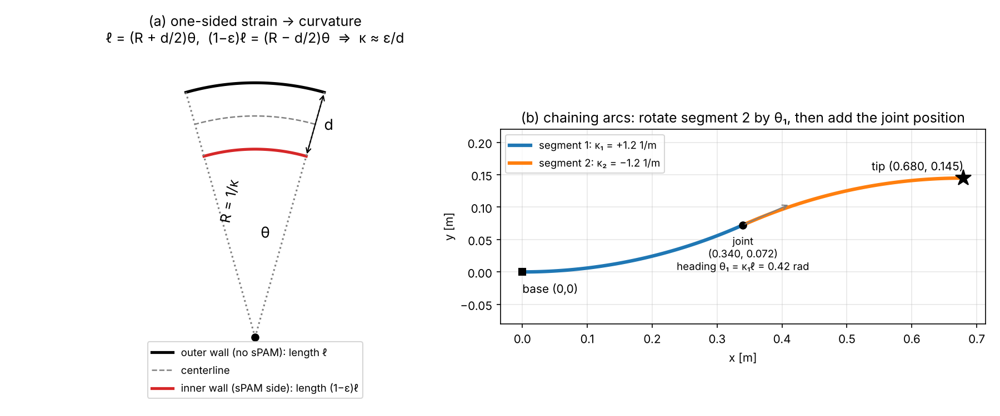

# Hand calculations

These are the analytical (pen-and-paper) models the PyElastica simulation is checked against.
Every number here is reproduced by `src/hand_calcs.py`. Run it to see each step, and change the inputs to redo the math for your own tube.

**Placeholder inputs** (replace with measured values):

| Symbol | Meaning | Value | Comes from |
|---|---|---|---|
| $d$ | body diameter | 0.05 m | your tube |
| $L$ | grown length | 0.70 m | B3 setup |
| $\ell = L/2$ | length of each segment | 0.35 m | design |
| $EI_\text{eff}$ | effective bending stiffness | 0.05 N·m² | **B0 test** |
| $\varepsilon$ | sPAM contraction strain | 0.05–0.08 | **B2 test** |

---

## 1. Curvature from one-sided strain: $\kappa \approx \varepsilon / d$

**Setup.** Take a short piece of vine with an sPAM on one side (figure, panel a).
The sPAM shortens its side by a fraction $\varepsilon$, and the opposite wall keeps its length $\ell$.
The piece bends into an arc of angle $\theta$ about a center of curvature.

**Geometry.** Both walls subtend the same angle $\theta$. The outer wall sits at radius $R + d/2$ and the inner wall at $R - d/2$:

$$
\ell = \left(R + \tfrac{d}{2}\right)\theta, \qquad (1-\varepsilon)\,\ell = \left(R - \tfrac{d}{2}\right)\theta
$$

**Subtract** the second equation from the first:

$$
\varepsilon\,\ell = d\,\theta \quad\Longrightarrow\quad \frac{\theta}{\ell} = \frac{\varepsilon}{d}
$$

Because $\theta/\ell$ is the curvature measured along the outer wall, and $d \ll R$, the centerline curvature is

$$
\boxed{\kappa = \frac{1}{R} \approx \frac{\varepsilon}{d}}
$$

**Numbers** ($d$ = 0.05 m):

| $\varepsilon$ | $\kappa = \varepsilon/d$ | $R = 1/\kappa$ |
|---|---|---|
| 0.05 | 1.00 m⁻¹ | 1.000 m |
| 0.06 | 1.20 m⁻¹ | 0.833 m |
| 0.08 | 1.60 m⁻¹ | 0.625 m |

> **What this ignores.** The pressurized body resists bending, so the real sPAM can't reach its free strain $\varepsilon$ once it's on the vine. Expect measured $\kappa$ to fall **below** $\varepsilon/d$. How far below, as a function of the ratio of sPAM pressure to body pressure, is exactly what experiment **B3** measures.

---

## 2. Shape of one constant-curvature segment

A segment with constant curvature $\kappa$ starts at the origin pointing along $+x$. Its heading at arc length $s$ is $\phi(s) = \kappa s$. The centerline obeys

$$
\frac{dx}{ds} = \cos(\kappa s), \qquad \frac{dy}{ds} = \sin(\kappa s)
$$

Integrating from $0$ to $\ell$:

$$
\boxed{\;x = \frac{\sin(\kappa\ell)}{\kappa}, \qquad y = \frac{1-\cos(\kappa\ell)}{\kappa}, \qquad \theta = \kappa\ell\;}
$$

(For $\kappa = 0$ the segment is straight: $x = \ell,\ y = 0$.)

---

## 3. Chaining two segments (piecewise-constant curvature, PCC)

Segment 2 starts where segment 1 ends, pointing along segment 1's final heading $\theta_1$ (figure, panel b). So:

1. Compute segment 1's end $(x_1, y_1)$ and heading $\theta_1$ with Section 2.
2. Compute segment 2's displacement $(\Delta x, \Delta y)$ **in its own frame** with Section 2.
3. Rotate that displacement by $\theta_1$ and add it to the joint position:

$$
\begin{bmatrix} X \\ Y \end{bmatrix} =
\begin{bmatrix} x_1 \\ y_1 \end{bmatrix} +
\begin{bmatrix} \cos\theta_1 & -\sin\theta_1 \\ \sin\theta_1 & \cos\theta_1 \end{bmatrix}
\begin{bmatrix} \Delta x \\ \Delta y \end{bmatrix},
\qquad \theta_\text{tip} = \theta_1 + \theta_2
$$

### Worked example: S-shape ($\varepsilon_1 = +0.06$, $\varepsilon_2 = -0.06$)

$\kappa_1 = +1.2$ m⁻¹, $\kappa_2 = -1.2$ m⁻¹, $\ell$ = 0.35 m

**Segment 1**
- $\theta_1 = \kappa_1 \ell = 1.2 \times 0.35 = 0.420$ rad (24.1°)
- $x_1 = \sin(0.420)/1.2 = 0.40776/1.2 = 0.3398$ m
- $y_1 = (1-\cos 0.420)/1.2 = (1-0.91309)/1.2 = 0.0724$ m

**Segment 2, own frame**
- $\theta_2 = -1.2 \times 0.35 = -0.420$ rad
- $\Delta x = \sin(-0.420)/(-1.2) = 0.3398$ m
- $\Delta y = (1-\cos(-0.420))/(-1.2) = -0.0724$ m

**Rotate by $\theta_1$ and add** ($\cos\theta_1 = 0.91309$, $\sin\theta_1 = 0.40776$)
- $X = 0.3398 + 0.91309(0.3398) - 0.40776(-0.0724) = 0.3398 + 0.3103 + 0.0295 = \mathbf{0.6796}$ m
- $Y = 0.0724 + 0.40776(0.3398) + 0.91309(-0.0724) = 0.0724 + 0.1386 - 0.0661 = \mathbf{0.1449}$ m
- $\theta_\text{tip} = 0.420 - 0.420 = 0$, so the tip ends up pointing straight along $+x$ again, as expected for a symmetric S-curve.

### All three cases

| Case | $\kappa_1, \kappa_2$ (m⁻¹) | Hand tip $(X, Y)$ (mm) | PyElastica tip (mm) | Difference (mm) |
|---|---|---|---|---|
| C-shape | 1.0, 1.0 | (644.2, 235.2) | (645.4, 231.9) | 3.5 |
| S-shape | 1.2, −1.2 | (679.6, 144.9) | (680.5, 140.8) | 4.2 |
| Tip-only | 0, 1.6 | (682.0, 95.5) | (682.0, 95.5) | < 0.1 |

The C-shape is a single arc: $X = \sin(0.7)/1 = 0.6442$ m, $Y = 1-\cos(0.7) = 0.2352$ m, which matches the chained result.

The few-mm gap is **simulation discretization**, not physics. Doubling the number of rod elements halves it (S-shape tip error: 16.9 → 4.2 → 2.2 mm at 35 → 70 → 140 elements).

---

## 4. Picking Young's modulus for PyElastica

PyElastica computes the bending inertia as a **solid** circular rod, $I = \pi r^4/4$. Our vine is a thin pressurized tube whose stiffness comes mostly from pressure, not the material. So we don't use the film's real $E$. We choose $E$ so that the product $EI$ equals the measured $EI_\text{eff}$:

$$
I_\text{solid} = \frac{\pi r^4}{4} = \frac{\pi (0.025)^4}{4} = 3.068\times10^{-7}\ \text{m}^4
$$

$$
E = \frac{EI_\text{eff}}{I_\text{solid}} = \frac{0.05}{3.068\times10^{-7}} = 1.63\times10^{5}\ \text{Pa}
$$

> **The bug this avoids.** Using the thin-tube formula $I = \pi r^3 t$ (with $t$ = 1 mm) gives $E = 1.02\times10^6$ Pa. PyElastica would then multiply that by its solid $I$, producing $EI = 0.31$ N·m², a vine **6.25× too stiff**. The tip-load check in Section 5 is what caught this.

---

## 5. Cantilever tip deflection (mirrors experiment B0)

An unactuated vine is clamped at the base, lying horizontal with gravity out of plane, and a force $F$ is applied sideways at the tip.

**Small-deflection (Euler–Bernoulli) theory.** The bending moment at distance $s$ from the base is $M(s) = F(L-s)$. Integrating $EI\,w'' = M$ twice, with $w(0) = w'(0) = 0$, gives

$$
\boxed{\delta = \frac{F L^3}{3\,EI}}
$$

With $L^3 = 0.343$ m³ and $3EI = 0.15$ N·m²:

| $F$ (N) | Linear $\delta$ (mm) | $\delta / L$ | Large-deflection $\delta$ (mm) | PyElastica (mm) |
|---|---|---|---|---|
| 0.05 | 114.3 | 0.16 | 111.3 | 109.2 |
| 0.10 | 228.7 | 0.33 | 207.7 | 204.1 |
| 0.20 | 457.3 | 0.65 | 340.8 | 336.8 |

**Why linear theory overshoots.** It assumes the tip moves straight sideways and the vine never shortens its lever arm. For $\delta/L$ above about 0.1, that breaks down: as the vine curls, the tip moves back toward the base, shortening the moment arm. The **large-deflection (elastica)** model solves the exact equation

$$
EI\,\theta'' = -F\cos\theta, \qquad \theta(0) = 0,\quad \theta'(L) = 0
$$

numerically (`src/large_deflection_check.py`, using `scipy.integrate.solve_bvp`). PyElastica agrees with it to within 2%.

**Using this in B0.** Keep loads small enough that $\delta/L < 0.1$, then solve for stiffness:

$$
EI_\text{eff} = \frac{F L^3}{3\,\delta}
$$

Repeat at 3 body pressures to get $EI_\text{eff}(p)$.

---

## 6. Sanity checks at a sample body pressure

At $p$ = 7 kPa, $r$ = 0.025 m, film thickness $t$ = 0.1 mm (all placeholders):

| Quantity | Formula | Value |
|---|---|---|
| Hoop stress | $\sigma_\theta = pr/t$ | 1.75 MPa |
| Axial stress | $\sigma_z = pr/(2t)$ | 0.88 MPa |
| Wrinkling moment | $M_w = \pi p r^3/2$ | 172 N·mm |
| Tip force | $F \approx p\,\pi r^2$ | 13.7 N |

The hoop stress is twice the axial stress, which is why tubes split lengthwise. Compare it against your film's yield strength once you know the material. The wrinkling moment is the most bending moment the body can carry before it kinks.
